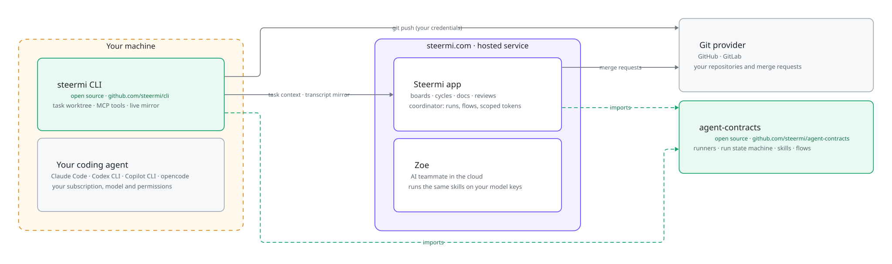

# agent-contracts

The rules that the Steermi service and the
[`steermi` CLI](https://github.com/steermi/cli) both compile against: what an
agent run is allowed to do, how it moves between states, what a person can
accept as evidence, and the identifiers a local launch uses.

It is a plain Go library with no network or storage code, so the two sides
cannot drift apart without a test failing.

<p align="center">
  <picture>
    <source media="(prefers-color-scheme: dark)" srcset="docs/images/ecosystem-dark.svg">
    
  </picture>
</p>

```bash
go get github.com/steermi/agent-contracts
```

Needs Go 1.27.3 or newer. Runtime dependencies: `golang.org/x/text` and
`gopkg.in/yaml.v3`.

## How it works

In Steermi, people pick a **skill** and Zoe, Steermi's AI teammate, runs it.
A skill declares what it hands back (`metadata.steermi-result`), and that
alone decides its **runner**, and so what the run may touch:

| Runner | The skill hands back | The run may |
|---|---|---|
| `answer` | an answer and proposals (docs, work items, comments) | read and propose; never change a repository |
| `code` | commits on a branch and a merge request | read and write repositories, open merge requests |
| `findings` | an independent assessment of pinned outputs | read and comment; never write |

Plan, Build and Review are just the built-in skills for these three runners
(`steermi:plan`, `steermi:build`, `steermi:review`).

Three rules hold everywhere:

- **Capabilities restrict, they never grant.** They are allowlists, and an
  unknown tool is refused. The caller's own authorization still applies.
- **Evidence is not acceptance.** An agent submits outputs. A different
  person accepts that exact evidence digest, and only once the
  provider-verified checks have passed. Nobody accepts their own work.
- **Stale input is rejected.** Every command carries the run version. Moving
  a run to your machine or back to the cloud starts a new generation, so an
  older launch cannot finish it.

## Example

```go
dev := activity.Actor{OrgID: "org", UserID: "dev", Role: "member"}
run, err := activity.NewRun("run-1", "org", "project", "item", dev, activity.Request{
	Runner: activity.Code, Location: activity.Local, InputDigest: activity.Digest("ticket@1"),
}, nil)
err = run.Apply(dev, activity.Command{Type: activity.Confirm, ExpectedVersion: run.Version})
```

[`activity/example_test.go`](activity/example_test.go) runs a full
confirm → start → submit → accept cycle, including the refusals:

```bash
go test ./activity -run Example -v
```

## Packages

| Package | What it holds |
|---|---|
| [`activity`](activity) | Runners, capability allowlists, the run state machine (`Run.Apply`), evidence digests and board rules. |
| [`skill`](skill) | Skills as folders with a `SKILL.md` (Agent Skills format): parsing, zip import and export, validation, capability narrowing. |
| [`skill/builtin`](skill/builtin) | The built-in skills, embedded. Their text is the prompt of a run. |
| [`skill/inputs`](skill/inputs) | The start form a skill can ship (`inputs.schema.json`, a closed JSON Schema subset). |
| [`skill/board`](skill/board) | The board definition for skills that hand back a board (`board.yaml`). |
| [`flow`](flow) | Delivery flows: graphs of agent steps, quality loops and approvals, with validation and a simulator. |
| [`hint`](hint) | Suggests a model tier and effort for a run. It never names a model. |
| [`locallaunch`](locallaunch) | Launch IDs, device secrets, PKCE (S256) and launch branch names. |

Details are in each package's Go documentation.

## What is not here

The coordinator that stores runs, dispatches agents, isolates tenants and
talks to Git providers belongs to the hosted Steermi service and is not open
source.

## Stability

This is 0.x: the API may change between minor versions, and every change is
in [CHANGELOG.md](CHANGELOG.md). Wire shapes, digests and capability decisions
are locked by golden files in [`testdata/compat`](testdata/compat); see
[docs/compatibility.md](docs/compatibility.md) before changing them.

## Contributing

[CONTRIBUTING.md](CONTRIBUTING.md) has the development loop; `make check`
runs what CI runs. Report security problems privately, as described in
[SECURITY.md](SECURITY.md).

## License

[Apache-2.0](LICENSE). Third-party notices are in
[THIRD_PARTY_NOTICES.md](THIRD_PARTY_NOTICES.md).
